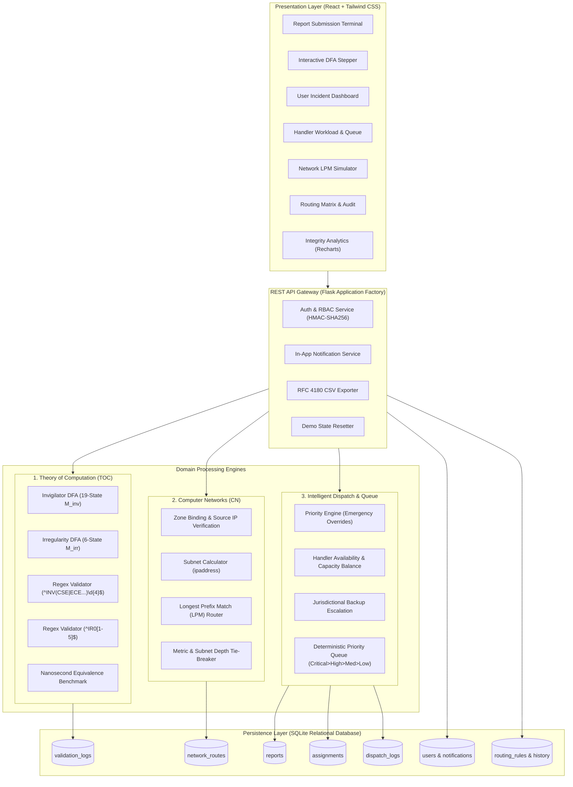

# System Architecture — IRIS

IRIS (Examination Hall Irregularity Reporting and Intelligent Dispatch System) is architected around a decoupled, three-tier model bridging **Theory of Computation (TOC)**, **Computer Networks (CN)**, and **Full-Stack Systems**.

