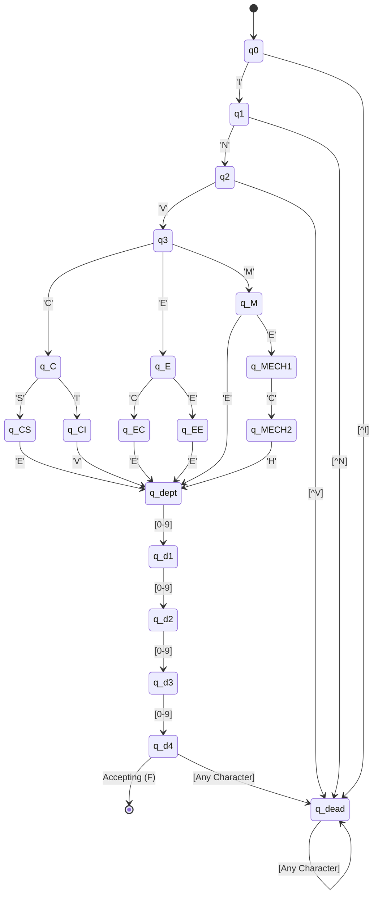
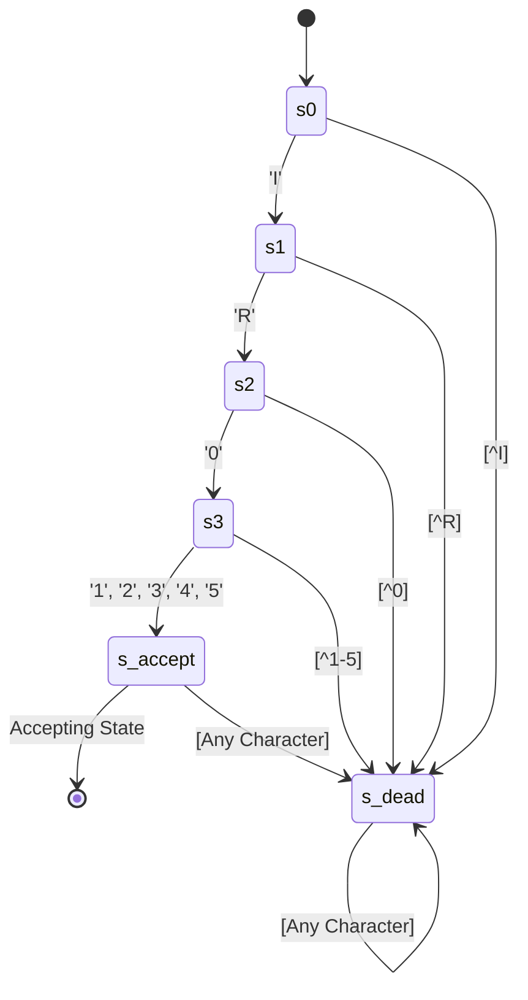

# Automata Theory (TOC) — Formal DFA State Diagrams

IRIS formally validates all input tokens character-by-character using Deterministic Finite Automata (DFA) defined as 5-tuples:
$$M = (Q, \Sigma, \delta, q_0, F)$$

---

## 1. Invigilator ID DFA ($M_{\text{inv}}$)
**Grammar**: `INV` followed by department code (`CSE`, `ECE`, `EEE`, `CIV`, `ME`, `MECH`), followed by 4 digits $[0-9]^4$.

---

## 2. Irregularity ID DFA ($M_{\text{irr}}$)
**Language**: Strictly accepts $L = \{ \text{IR01}, \text{IR02}, \text{IR03}, \text{IR04}, \text{IR05} \}$. Rejects IR06-IR99, IR1, IR001, etc.

---

## 3. Formal Equivalence & Benchmark Assertion
Each input token is evaluated through both:
1. $M(w)$: Character-by-character DFA simulator.
2. $R(w)$: Compiled POSIX Regex (`re.fullmatch()`).

Both algorithms record timestamp delta in nanoseconds using Python `time.perf_counter_ns()`:
$$\Delta t = t_{\text{end}} - t_{\text{start}}$$

If $M(w) \neq R(w)$, IRIS aborts ingestion immediately with an `ENGINE_EQUIVALENCE_CONFLICT` failure.

