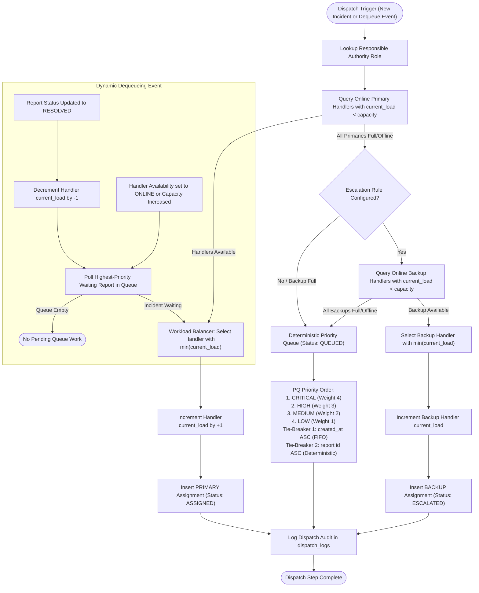

# Intelligent Dispatch & Deterministic Priority Queue Flowchart

The IRIS Dispatch Engine guarantees deterministic, non-starving allocation using capacity bounds, workload balancing, and a 4-tier deterministic priority queue.

