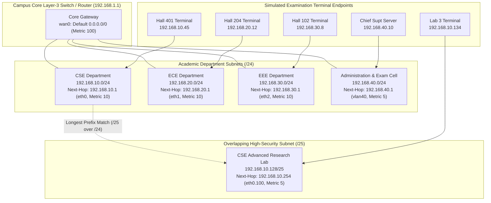

# Computer Networks (CN) — Academic Layer-3 Topology & Routing

IRIS simulates an enterprise academic Layer-3 routed network environment.

---

## Longest Prefix Matching (LPM) Example
When terminal `192.168.10.134` sends an incident packet:
1. `192.168.10.134` matches `192.168.10.0/24` (Prefix length 24).
2. `192.168.10.134` also matches `192.168.10.128/25` (Prefix length 25).
3. **LPM Rule**: Prefix length $25 > 24$.
4. **Resolution**: Packet is routed via interface `eth0.100` to Next-Hop `192.168.10.254` (Metric 5).

